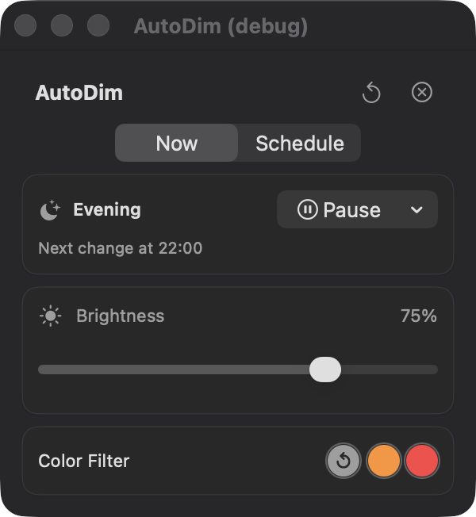
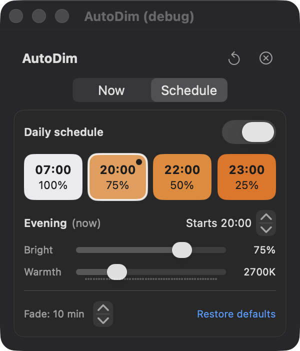

# AutoDim

AutoDim is a macOS menu bar app that dims your screen and removes blue light on a daily schedule, so your display winds down before bedtime.

## Credit

AutoDim is a fork of [DisplayFilter](https://github.com/uyasarkocal/DisplayFilter) by Yaşar Koçal (MIT licensed). The menu bar app, gamma-table dimming and color filters are his work; the daily schedule, color-temperature phases, persistence, launch at login and multi-display fixes were added on top. The original copyright notice is kept in `LICENSE`. DisplayFilter was inspired by [MonitorControl](https://github.com/MonitorControl/MonitorControl) and [f.lux](https://justgetflux.com/).

## Features

- Built-in daily schedule: full brightness and no filter from 07:00, then three progressively dimmer and warmer evening phases (defaults 20:00, 22:00, 23:00), each fading in over 10 minutes; all times, brightness and color temperatures are editable
- Pause: "Until next phase", "For 1 hour" or "Until tomorrow" returns the screen to normal, then the schedule resumes
- Manual changes hold until the next scheduled boundary, then the schedule resumes
- Hardware brightness control for the built-in display, plus DDC/CI brightness control for external displays that expose it; unsupported displays use software dimming
- Restores each controlled display's prior brightness when paused, disabled or quit, and preserves a recovery value after an unexpected quit
- Warm manual color filters (orange, red) with adjustable intensity, applied to all connected displays
- Lives in the menu bar, with a Now tab and a Schedule tab

 

AutoDim uses the Mac's hardware brightness control for the built-in display. It tries DDC/CI for external displays, which can work over USB-C, DisplayPort or HDMI when the monitor, cable and dock pass DDC commands. The menu identifies displays that need software dimming instead. Colour temperature remains a software gamma adjustment.

## Install

Requires macOS 13.0 or later on an Intel or Apple Silicon Mac.

**Download:** get the current `AutoDim` DMG from [Releases](https://github.com/cipshadow/autodim/releases), open it and drag `AutoDim.app` to Applications. The app is ad-hoc signed and not notarized, so at first launch Control-click `AutoDim.app`, choose **Open**, then confirm **Open**. If macOS does not offer that option, attempt to open it once, then use **System Settings > Privacy & Security > Open Anyway**. Do not disable Gatekeeper or remove the app's quarantine attribute.

**Or build from source:**

1. Clone this repository.
2. Run `./build.sh` (needs only the Xcode Command Line Tools, not full Xcode). It builds and ad-hoc signs `build/AutoDim.app`.
3. Copy `build/AutoDim.app` to `/Applications` and open it.
4. To start it at login, add it in System Settings, General, Login Items. The schedule only runs while the app is open.

If Spotlight opens AutoDim but no window appears, that is normal for this menu-only app. Look for the half-moon at the right of the menu bar. If it is missing while AutoDim is running, open **System Settings > Menu Bar > Allow in the Menu Bar**, and turn AutoDim off and on again. Check both menu bars if you use more than one screen. If the installed app still reports an older version, replace it with the current DMG's app in `/Applications` and reopen it.

Other gamma-based tools such as f.lux change the same display settings; run only one at a time.

## Why these defaults

What the research supports, and what it does not:

- Evidence: expert consensus recommends low evening light starting at least 3 hours before bedtime ([Brown et al. 2022](https://journals.plos.org/plosbiology/article?id=10.1371%2Fjournal.pbio.3001571)), and evening light suppresses melatonin in a dose-dependent way ([Gooley et al. 2011](https://pubmed.ncbi.nlm.nih.gov/21193540/), [Phillips et al. 2019](https://www.pnas.org/doi/10.1073/pnas.1901824116)).
- Evidence: on a tablet, a warm filter alone did not reduce melatonin suppression, but a lower brightness combined with the filter did ([Nagare et al. 2019](https://pubmed.ncbi.nlm.nih.gov/31191118/)). Brightness does most of the work here; warmth is secondary.
- Evidence: in a display study, melanopic content (the part of the light the body clock responds to) drove melatonin, sleep latency and alertness effects, independent of how the screen looked ([PMC9974389](https://pmc.ncbi.nlm.nih.gov/articles/PMC9974389/)). Removing blue lowers it.
- Not shown: I found no randomized trial showing that software filters like this improve sleep, and people differ more than 50-fold in sensitivity to evening light. The phase times and strengths are defaults to tune, not tested doses, and room lighting matters too.

## Development

- `./build.sh debug` adds the `--simulate-time HH:MM` and `--debug-window` launch arguments for testing the schedule.
- `./build.sh check` runs the schedule math checks.
- `swift Checks/GammaRecovery.swift` checks recovery after a display color-table reset. Run it with AutoDim open during a stable, non-neutral phase; it briefly clears the built-in display's tint and waits up to 40 seconds for recovery.
- `VERSION=1.1.0 ./build.sh package` creates `build/AutoDim-1.1.0.dmg` and its SHA-256 file, then verifies the mounted app's signature and both CPU architectures. Use this command for release uploads rather than Finder's Compress action.
- The Xcode project (`DisplayFilter.xcodeproj`) also builds the app but has not been built on the maintainer's machine.

## License

MIT, see [LICENSE](LICENSE).
